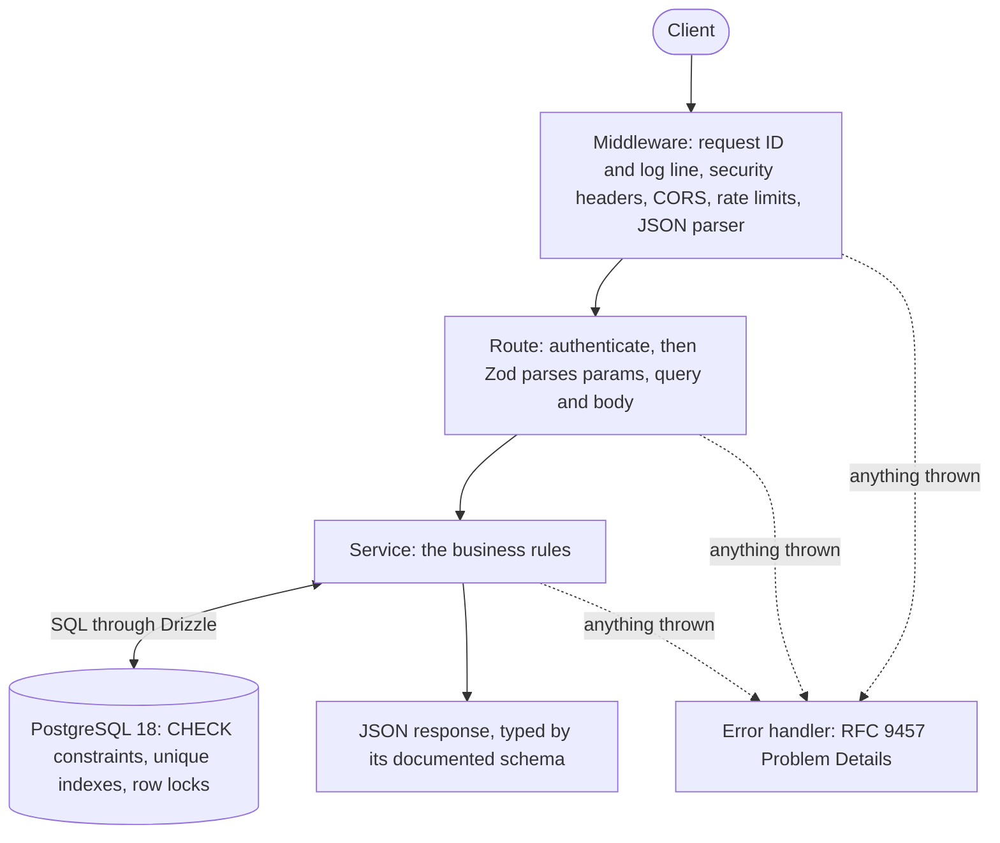
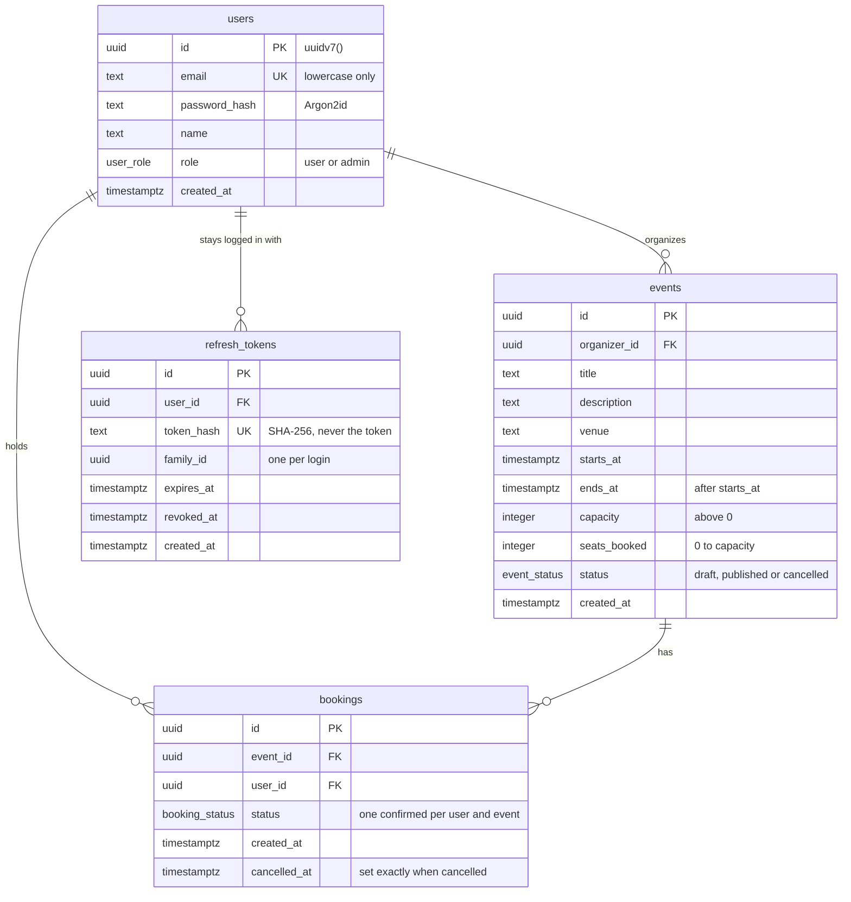

# Kursi

A REST API for booking seats at events that never sells more seats than an event has, even when 50 people try to book its 10 seats at the same moment. Built with Node.js 26, TypeScript, Express 5 and PostgreSQL 18.

[](https://github.com/bakirsobashy/kursi/actions/workflows/ci.yml)


_The interactive docs at `/docs`: log in with the pre-filled demo account, book the workshop's last seat, then try again._

The same concurrency test, before and after the fix. 50 people book a 10-seat event at once:

```text
First version: read the seat count, check it in TypeScript, then write it back

  AssertionError: expected { booked: 50, soldOut: +0, …(2) } to deeply equal { booked: 10, soldOut: 40, …(2) }

  - Expected
  + Received

    {
  -   "booked": 10,
  -   "confirmedBookingsInTheDatabase": 10,
  -   "seatsBookedCounter": 10,
  -   "soldOut": 40,
  +   "booked": 50,
  +   "confirmedBookingsInTheDatabase": 50,
  +   "seatsBookedCounter": 1,
  +   "soldOut": 0,
    }

Now: one conditional UPDATE

  ✓ booking under load > sells exactly 10 seats when 50 people book at once (repeat x19)
```

The first version sold all 50 requests a seat, and its counter said 1 seat was taken. The fixed version sells exactly 10, turns 40 away as sold out, and keeps the counter equal to the bookings, on every one of 20 runs.

## Highlights

- **Race-free booking.** A seat is taken by one statement: `UPDATE events SET seats_booked = seats_booked + 1 WHERE … AND seats_booked < capacity`. Postgres locks the row, so requests for the same event queue up and each re-checks the condition against the latest count. No request can act on a stale count. See [the decision](docs/decisions.md#3-booking-a-seat-is-one-conditional-update).
- **Rotating refresh tokens with reuse detection.** Login gives a 15-minute access token and a refresh token in an HttpOnly, SameSite=Strict cookie. Each refresh replaces the token, and a replayed old token ends the whole session, because it means someone kept a copy.
- **Rules enforced by PostgreSQL.** CHECK constraints keep seats between 0 and the capacity and end times after start times; a partial unique index allows one confirmed booking per person per event. Even a bug in the code can't break them, and a violation the code didn't expect still answers 409, not 500.
- **Docs generated from the validation schemas.** The OpenAPI 3.1 document comes from the same Zod schemas that validate requests. Every response in the test suite is checked against it, so the docs can't drift from the code.
- **Production basics.** [RFC 9457](https://www.rfc-editor.org/rfc/rfc9457) errors that link to [their explanation](docs/problems.md), rate limits, security headers, CORS, request IDs, health and readiness checks, graceful shutdown, and a non-root Docker image tested on amd64 and arm64.

## Quick start

You need Docker. From a fresh clone:

```sh
cp .env.example .env
docker compose up --build
```

Open **http://localhost:3000/docs**. Compose starts PostgreSQL, applies the migrations, adds the demo data, and starts the API once the database is ready.

On the docs page, press **Execute** on **Log in**: it's pre-filled with Alice's account, and the page then authorizes every other request for you. All three demo accounts use the password `demo-password`:

| Account            | Role  | Demo data                                                                                          |
| ------------------ | ----- | -------------------------------------------------------------------------------------------------- |
| `alice@kursi.test` | user  | Organizes the TypeScript Workshop (3 seats, 2 booked) and a meetup; booked on the PostgreSQL intro |
| `bob@kursi.test`   | user  | Organizes the PostgreSQL intro and a draft that only he and the admin can see                      |
| `admin@kursi.test` | admin | Can manage every event                                                                             |

From a terminal instead (with `jq`), log in and book the workshop's last seat:

```sh
TOKEN=$(curl -s http://localhost:3000/api/v1/auth/login -H 'Content-Type: application/json' \
  -d '{"email":"alice@kursi.test","password":"demo-password"}' | jq -r .accessToken)
curl -s -X POST http://localhost:3000/api/v1/events/0199a3c2-0000-7000-8000-000000000102/bookings \
  -H "Authorization: Bearer $TOKEN" | jq
```

Stop with Ctrl+C. `docker compose down --volumes` also deletes the data.

## Architecture

Routes stay thin: they parse input with Zod and send responses. Services hold the rules and the SQL. A test fails if a route imports the database or a service touches `req` or `res`.





```text
src/
  routes/       HTTP only: parse with Zod, call a service, send the result
  services/     business rules and SQL; no req or res
  schemas/      Zod schemas for requests and responses
  middleware/   authentication, rate limits, request logging, errors
  db/           Drizzle schema, migrations runner, demo seed
  docs/         the OpenAPI document and its examples
tests/          242 tests against a real PostgreSQL
docs/           problem types, deployment notes, decision log
```

## Endpoints

Every endpoint, with its parameters, examples and possible errors, is in the interactive docs at `/docs`. The raw OpenAPI document is at `/openapi.json`.

| Endpoint                            | Who                 | What it does                                          |
| ----------------------------------- | ------------------- | ----------------------------------------------------- |
| `POST /api/v1/auth/register`        | anyone              | Create an account                                     |
| `POST /api/v1/auth/login`           | anyone              | Get an access token and a refresh cookie              |
| `POST /api/v1/auth/refresh`         | refresh cookie      | Swap the refresh token for a new pair                 |
| `POST /api/v1/auth/logout`          | refresh cookie      | End the session                                       |
| `GET /api/v1/users/me`              | logged in           | Your account                                          |
| `GET /api/v1/users/me/bookings`     | logged in           | Your bookings, newest first                           |
| `GET /api/v1/events`                | anyone              | Upcoming published events, with search and date range |
| `POST /api/v1/events`               | logged in           | Create an event, as a draft                           |
| `GET /api/v1/events/{id}`           | anyone              | One event; a draft only for its organizer and admins  |
| `PATCH /api/v1/events/{id}`         | organizer or admin  | Change some of an event's fields                      |
| `POST /api/v1/events/{id}/publish`  | organizer or admin  | Publish a draft, which opens bookings                 |
| `POST /api/v1/events/{id}/cancel`   | organizer or admin  | Cancel an event and every booking for it              |
| `GET /api/v1/events/{id}/bookings`  | organizer or admin  | The event's attendees                                 |
| `POST /api/v1/events/{id}/bookings` | logged in           | Book a seat                                           |
| `POST /api/v1/bookings/{id}/cancel` | the booking's owner | Cancel a booking, before the event starts             |
| `GET /health`                       | anyone              | Liveness: the process answers                         |
| `GET /ready`                        | anyone              | Readiness: the database answers too                   |

## Testing

```sh
npm ci
npm test               # 242 tests, under a minute
npm run test:coverage  # with a coverage report in coverage/
```

The tests run against a real PostgreSQL 18, never mocks: Testcontainers starts a throwaway one in Docker, or set `TEST_DATABASE_URL` to use your own (its name must contain "test"). The race conditions, constraints and locks that matter here only show up against a real database.

- **The concurrency test** sends 50 booking requests from 50 different people at a 10-seat event, all before awaiting any response. It passes only if exactly 10 succeed, 40 get "sold out", and the database holds 10 confirmed bookings with a counter of 10. It runs 20 times, since a race that passes once might just have been lucky. A second test races 10 cancellations against 20 new bookings and checks that nothing deadlocks and the counter still matches.
- **Lock tests** hold a row lock from a second connection and watch `pg_stat_activity` until the request is waiting for it. They prove that cancelling locks the event before the booking, the order every write follows, which rules out deadlocks; that two simultaneous cancels free the seat only once; and that two refreshes with the same token can't both succeed.
- **The contract check** sends every response the tests get through the OpenAPI document. A status, field, header or error type the docs don't describe fails the test that caused it.
- **CI** runs on every pull request, and all four checks must pass before a merge: lint, format, types and tests; the developer setup and the full Docker Compose stack; and the Docker image built and started on amd64 and on arm64.

## Development

You need Node.js 26 and Docker for the database.

```sh
npm ci
cp .env.example .env
docker compose up -d db
npm run db:migrate
npm run db:seed
npm run dev            # restarts on every change
```

`npm run lint`, `npm run format` and `npm run typecheck` run the other CI checks locally. [docs/deployment.md](docs/deployment.md) covers secrets, running behind a proxy, and the Docker image.

## Decisions

[docs/decisions.md](docs/decisions.md) explains the choices behind the code, the alternatives, and what each one costs: PostgreSQL over MongoDB, a conditional UPDATE instead of `SELECT … FOR UPDATE` or SERIALIZABLE, a seat counter instead of counting rows, refresh-token rotation and its two-tabs trade-off, Argon2id and SHA-256, 404 instead of 403 for other people's drafts, and more.

## What I'd do next

- **Idempotency keys** for bookings, so a client retrying on a flaky connection gets the first response back instead of an error.
- **A grace period for refresh tokens**, so two tabs refreshing at the same moment don't end the session.
- **A waitlist**: a cancellation hands the seat to the next person in the same transaction.
- **Several seats per booking**: the conditional UPDATE becomes `seats_booked + quantity <= capacity`.
- **Cursor pagination** on `(starts_at, id)`, which stays fast and stable as the events table grows.
- **A k6 load test** with hundreds of virtual users, and its latency numbers here.

## License

[MIT](LICENSE)
